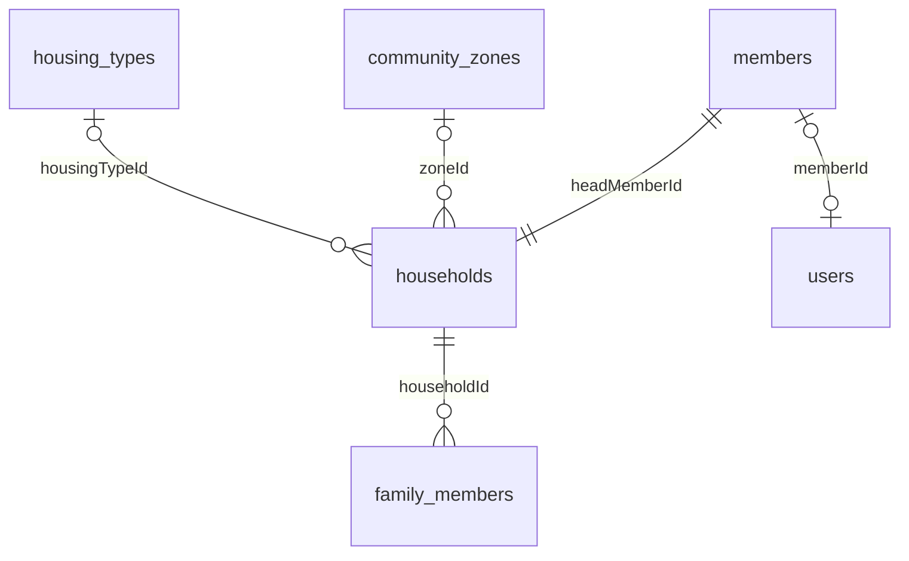

# Struktur data myKampung — penduduk dan isi rumah

Pangkalan data aplikasi kekal SQLite. Dump struktur myKapong digunakan sebagai rujukan fungsi, bukan diimport sebagai skema aplikasi. Jadual jualan, produk, penghantaran dan nama `orders` tidak digunakan.

## Jadual dan hubungan

| Jadual | Tanggungjawab |
| --- | --- |
| `users` | Akaun, hash kata laluan, peranan dan pautan `memberId` untuk portal ahli. |
| `members` | Profil ahli utama, status keahlian, maklumat peribadi/pekerjaan serta identiti rekod stabil. |
| `households` | Satu rekod isi rumah bagi setiap ahli utama melalui `headMemberId`; alamat, rujukan rumah, koordinat, `zoneId` dan `housingTypeId`. |
| `family_members` | Ahli keluarga isi rumah melalui `householdId`; nama, hubungan, tarikh lahir, pendidikan, pengenalan dan kebajikan. `position` mengekalkan susunan borang. |
| `community_zones` | Kod/nama zon dan status aktif. |
| `housing_types` | Kod/nama jenis rumah dan status aktif. |
| `registrations` | Permohonan pendaftaran penduduk. |
| `khairat_types` | Katalog kod/nama, jumlah bayaran dalam sen dan status aktif. |
| `khairat_documents` | Sijil kematian BLOB, metadata fail, SHA-256, pemuat naik dan tarikh; satu bagi tuntutan. |
| `member_module_access` | Tetapan akses modul untuk semua akaun berperanan Ahli. |
| `staff_module_access` | Tetapan akses modul Petugas yang berasingan daripada Ahli. |
| `khairat_claims` | Tuntutan waris, jumlah diluluskan dan rekod satu bayaran penuh berdasarkan rekod kematian rasmi. |
| `death_records` | Permohonan kematian individu, identiti stabil, tarikh, catatan dan keputusan pentadbir. |
| `household_head_changes` | Permohonan pertukaran ketua, cadangan keluarga, profil asal dan keputusan pentadbir. |
| `profile_requests` | Cadangan perubahan profil/keluarga/rumah dan keputusan semakan. |
| `aid_requests`, `aid_records` | Permohonan maklumat bantuan dan rekod bantuan rasmi. |

Kod katalog tidak diubah selepas penciptaan. Nama/status boleh diubah oleh pentadbir; rujukan isi rumah menggunakan foreign key kepada ID katalog. Katalog kosong pada pemasangan baharu. Tiada zon sebenar atau nilai rujukan daripada dump SQL yang diandaikan secara automatik.

## Keserasian dan pemilikan penulisan

API dan sandaran lama menggunakan `members.household` sebagai array keluarga dalam JSON, serta medan alamat/rumah pada ahli utama. Dalam fasa ini, bentuk tersebut dikekalkan supaya portal, permohonan lama, bantuan dan sandaran sedia ada terus berfungsi.

Semua penulisan rasmi berlaku melalui laluan aplikasi yang mengesahkan `members` dan JSON keluarga. Trigger SQLite membina/menyegerakkan `households` dan `family_members` dalam transaksi yang sama. Kedua-dua jadual menyediakan bentuk relasi untuk pertanyaan dan pembangunan seterusnya. Jangan menyunting jadual unjuran ini secara berasingan melalui SQL kerana API masih membaca bentuk keserasian pada `members`; ubah melalui aplikasi atau lapisan penulisan yang disokong.

Migrasi dijalankan semula dengan selamat ketika mula aplikasi. `householdKey` ialah identiti isi rumah yang kekal pada `members` dan `households`. `identityKey` mengenal pasti individu ketua semasa, manakala setiap keluarga mempunyai `personKey` stabil. Baris unjuran `family_members.id` boleh dibina semula apabila susunan atau kandungan berubah; gunakan `personKey` untuk identiti individu, bukan ID baris unjuran.

Apabila pertukaran diluluskan, `members.id` dan `householdKey` dikekalkan untuk hubungan isi rumah/bantuan. `identityKey` ditukar kepada `personKey` ketua baharu. Ketua lama menjadi keluarga dengan `personKey` daripada identiti lamanya. Hubungan keluarga disemak semula terhadap ketua baharu dalam transaksi yang sama. Akaun ahli ketua lama dinyahaktif dan pautannya dikosongkan; sesi ditamatkan. Akaun tidak dipindahkan antara individu.

`household_head_changes` menyimpan identiti isi rumah, ketua asal/calon, tarikh, sebab, cadangan, salinan profil asal dan keputusan. Salinan profil asal hanya didedahkan kepada pentadbir. Kelulusan memeriksa semula keadaan rekod asal untuk menolak cadangan lapuk. Nama/tarikh lahir penerima dalam bantuan sejarah tidak ditulis semula apabila ketua bertukar.

Memadam ahli utama akan menghapuskan unjuran rumah dan keluarga melalui cascade; sekatan bantuan rasmi sedia ada masih dikuatkuasakan oleh aplikasi. Nyahaktif ahli tidak memadam data tersebut.

## Medan dan pengesahan

- `identificationNumber`: teks alfanumerik 5–30 aksara, dibersihkan daripada ruang/sengkang dan dihurufbesarkan. Sifar awal dikekalkan. Ini pengesahan format, bukan pengesahan identiti oleh agensi kerajaan.
- `nickname`, `email`, `maritalStatus`: maklumat tambahan pilihan bagi ahli utama/keluarga.
- `monthlyIncome`, `disabilityIncome`: teks perpuluhan RM yang dinormalkan kepada dua tempat perpuluhan. Kosong bermaksud belum diketahui; `0.00` bermaksud sifar. Tiada pengiraan menggunakan float diperlukan untuk penyimpanan nilai ini.
- `disabilityStatus`: kosong, Ya atau Tidak. Nombor kad disimpan sebagai teks; butiran manfaat/nilai dikosongkan jika bukan Ya.
- `zoneCode`, `housingTypeCode`: kod rujukan yang dihantar oleh borang/API dan disahkan terhadap katalog; trigger memautkan ID katalog dalam isi rumah.
- `houseReference`, `latitude`, `longitude`: rujukan setempat dan koordinat berpasangan, dengan julat latitud ±90 dan longitud ±180.

Semakan pendua merangkumi nama/telefon sedia ada serta nombor pengenalan ahli utama dan keluarga. Amaran tidak membuktikan individu sama; aliran pengesahan pentadbir sedia ada dikekalkan.

## Sandaran dan pemulihan

JSON versi 8 menyimpan bentuk API ahli/keluarga, medan rumah, katalog serta `householdKey`, `identityKey` dan `personKey`. Ia tidak mengeksport ID unjuran keluarga/isi rumah secara berasingan. Pemulihan menyemak katalog, memasukkannya sebelum ahli, dan trigger membina semula hubungan rumah/keluarga. Pemulihan menggantikan rekod dalam satu transaksi dan kegagalan akan rollback.

Sandaran penuh SQLite menyimpan semua jadual termasuk akaun, permohonan dan mesej. Gunakan sandaran penuh sebelum naik taraf dan untuk pemindahan lengkap. Pertukaran ketua, rekod kematian dan tuntutan khairat tersedia. Sejarah/permohonan pertukaran ketua tidak dieksport melalui JSON; gunakan sandaran penuh untuk pemindahan lengkap. Pemulihan JSON mengekalkan sejarah pemasangan semasa dan mengikat semula pautannya menggunakan `householdKey`.

## Kediaman keluarga (sandaran JSON versi 7)

`family_members` turut menyimpan `livesWithMember` (Ya/Tidak/kosong) dan `residenceAddress1`, `residenceAddress2`, `residenceDistrict`, `residencePostcode`, `residenceState`, `residenceCountry`. Bentuk sama digunakan dalam JSON keluarga dan permohonan profil. Migration menambah kolum pada jadual sedia ada dan menggantikan trigger dalam transaksi untuk memasukkan medan baharu.

Status Ya menggunakan alamat ahli utama secara rujukan dan menyimpan medan alamat berasingan sebagai kosong, supaya tiada salinan alamat lama yang tersasar apabila alamat utama berubah. Status Tidak memerlukan Alamat 1 dan negara. Status kosong menandakan rekod lama belum disemak; tiada andaian tinggal bersama. Format JSON versi 7 menyimpan semua medan ini dan mengehadkan pemulihan kepada aplikasi yang memahaminya.

## Rekod kematian

`death_records` menyimpan `householdKey`, `personKey`, nama/tarikh lahir semasa permohonan, tarikh kematian, pemohon, catatan serta status pending/approved/rejected dan keputusan semakan. Indeks unik separa mengehadkan satu permohonan pending/approved bagi individu. Tiada foreign key kepada ID ahli/keluarga yang boleh dibina semula; sejarah kekal walaupun rekod sumber dipadam. Status dipaparkan apabila kunci individu masih sepadan.

Status kematian rasmi dibaca daripada keputusan approved dan tidak diterima sebagai nilai yang boleh diubah melalui borang profil. Kelulusan memeriksa identiti/nama/tarikh lahir semasa serta permohonan profil/pertukaran tertangguh. Keputusan, audit, notifikasi dan nyahaktif akaun portal berlaku dalam satu transaksi. Sesi diputuskan selepas commit. Semakan log masuk turut memeriksa status kematian bagi identiti ketua semasa, termasuk selepas pemulihan JSON. Rekod bantuan tidak ditulis semula.

Pertukaran ketua mengekalkan personKey individu yang meninggal dunia ketika dipindahkan ke keluarga. Calon meninggal dunia ditolak semasa permohonan dan semasa kelulusan. `isActive` kekal sebagai status keahlian/isi rumah dan tidak ditukar secara automatik, supaya pengurusan pengganti terus tersedia.

JSON versi 8 tidak mengandungi jadual kematian atau keputusan. Gunakan sandaran penuh SQLite untuk pemindahan lengkap. Pemulihan JSON tidak memadam jadual ini dan tidak memautkan status berdasarkan nombor ID ahli. Rekod lama tanpa identiti stabil memerlukan semakan; pemulihan penuh ialah kaedah yang disokong untuk memelihara keseluruhan hubungan sejarah.

## Tuntutan dan bayaran khairat

`khairat_claims.deathRecordId` merujuk `death_records.id` dengan ON DELETE RESTRICT. Nama/tarikh kematian dibaca daripada rekod kematian rasmi yang kekal. `householdKey` menyimpan pemilikan isi rumah yang stabil supaya akses kekal selepas pertukaran ketua. Tuntutan menyimpan maklumat waris, pemohon, catatan, keputusan dan butiran bayaran; tiada akaun bank atau pemindahan wang dilaksanakan.

Status bergerak pending → approved → paid atau pending → rejected. Indeks unik separa membenarkan hanya satu tuntutan pending/approved/paid bagi satu rekod kematian; tuntutan ditolak boleh dihantar semula sebagai rekod baharu. `amountCents` ialah integer sen positif yang disahkan pentadbir semasa kelulusan. Tuntutan baharu menyimpan `typeId`, `typeName` dan `typeAmountCents` pada masa penghantaran; jumlah kelulusan mesti sama dengan kadar yang disalin. Tuntutan lama tanpa jenis masih menggunakan jumlah manual. Bayaran menggunakan jumlah sama, dengan tarikh/kaedah/rujukan, dan tidak menyokong ansuran atau bayaran berulang. Keputusan/bayaran memeriksa `expectedUpdatedAt`, status semasa dan peranan. Kelulusan serta bayaran memerlukan kata laluan pentadbir dan pengesahan. Penulisan status, audit dan notifikasi adalah atomik.

Jadual ini diasingkan daripada `aid_records`, supaya bantuan biasa dan khairat tidak dijumlahkan dua kali. Ringkasan UI mengira tuntutan diluluskan belum dibayar dan tuntutan dibayar secara berasingan, menggunakan integer sen. Kadar tuntutan baharu datang daripada katalog yang diurus pentadbir; tiada pengiraan baki tabung dalam fasa ini.

Sandaran penuh SQLite merangkumi jadual khairat bersama rekod kematian/akaun. JSON versi 8 tidak mengeksportnya dan tidak menggantikannya semasa pemulihan. Jangan menggunakan pemulihan JSON untuk membatalkan rekod bayaran. Pemulihan penuh ke tarikh lama memerlukan penyelarasan dengan rekod transaksi sebenar bagi mengelakkan bayaran berganda di luar sistem.

## Lampiran, katalog dan akses

`khairat_types` menggunakan kod kekal dan foreign key nullable pada tuntutan untuk keserasian lama. Katalog kosong pada pemasangan/naik taraf pertama. Kadar/nama pada tuntutan ialah snapshot dan tidak ditulis semula semasa katalog berubah. Jenis tidak dipadam melalui API; gunakan status tidak aktif.

`khairat_documents.claimId` ialah primary key serta foreign key kepada tuntutan. Sijil disimpan secara atomik bersama tuntutan baharu; kegagalan menyimpan dokumen membatalkan tuntutan. Rekod lama yang masih pending boleh menerima satu lampiran tambahan, dengan pemeriksaan status/versi terkini. Jenis fail disemak melalui MIME, sambungan, tandatangan awal kandungan dan base64/saiz sah; ini tidak mengesahkan keaslian sijil. Maksimum 5 MB bagi PDF/JPEG/PNG. Fail dimuat turun sebagai attachment selepas autentikasi, akses modul dan skop isi rumah diperiksa, tanpa laluan fail awam atau HTML pratonton. Metadata sahaja dihantar dalam senarai tuntutan.

`member_module_access` menyimpan satu konfigurasi boolean bagi modul Ahli. Semua pilihan asal dibenarkan semasa migrasi. Had kuasa peranan kekal dikuatkuasakan oleh laluan sedia ada; pilihan modul tidak boleh menambah kuasa kelulusan pentadbir. API memeriksa pilihan modul pada setiap permintaan Ahli dan papan pemuka menapis maklumat modul yang disekat. Tetapan hanya boleh ditukar pentadbir dengan kata laluan dan expectedUpdatedAt; penulisan diaudit. Profil/keluarga/bantuan dikumpulkan sebagai satu modul. Tiada pengecualian individu dalam versi ini.

Katalog, dokumen, snapshot kadar dan konfigurasi akses memerlukan sandaran penuh SQLite. JSON versi 8 tidak mengeksport atau menggantikan jadual ini semasa pemulihan. Fail BLOB ikut disalin oleh backup SQLite dan tidak memerlukan folder lampiran berasingan.

## Akses Petugas

`staff_module_access` mempunyai konfigurasi/versi berasingan daripada `member_module_access`. Pilihan Petugas ialah members, aid, community, questions, notifications, headChanges, deaths dan khairat. Migrasi mengekalkan akses asal dengan default true dan tidak menulis semula tetapan Ahli. GET/PUT `/api/access-settings?role=petugas` hanya untuk pentadbir; role=ahli atau parameter tiada mengekalkan kontrak sebelumnya. Perubahan memerlukan kata laluan dan expectedUpdatedAt serta diaudit.

Semakan modul pada pelayan meliputi GET dan mutasi untuk Petugas serta Ahli, termasuk dokumen. `/api/members` dan laluan bantuan mempunyai pilihan berasingan. `/api/module-households?module=aid|headChanges|deaths` menyediakan hanya rujukan minimum bagi modul yang dibenarkan kepada Petugas/pentadbir: id/nama/status, serta nama/tarikh lahir keluarga untuk bantuan. Ia tidak membuka direktori penuh jika members=false. Konteks pertukaran ketua/kematian terus mempunyai pengesahan modul masing-masing. Endpoint kelulusan dan pentadbiran kekal memeriksa role=admin.

Papan pemuka menapis ringkasan ahli, notifikasi, pertanyaan dan aktiviti mengikut pilihan Petugas. Semua konfigurasi termasuk dalam backup SQLite; JSON versi 8 tidak mengandungi konfigurasi ini.
