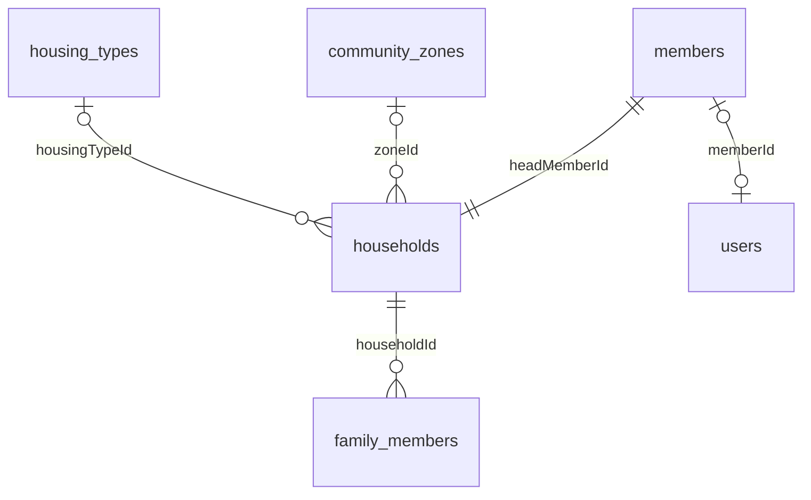

# Struktur data myKampung — fasa pertama

Pangkalan data aplikasi kekal SQLite. Dump struktur myKapong digunakan sebagai rujukan fungsi, bukan diimport sebagai skema aplikasi. Jadual jualan, produk, penghantaran dan nama `orders` tidak digunakan.

## Jadual dan hubungan

| Jadual | Tanggungjawab |
| --- | --- |
| `users` | Akaun, hash kata laluan, peranan dan pautan `memberId` untuk portal ahli. |
| `members` | Profil ahli utama, status keahlian, maklumat peribadi/pekerjaan serta identiti rekod stabil. |
| `households` | Satu rekod isi rumah bagi setiap ahli utama melalui `headMemberId`; alamat, rujukan rumah, koordinat, `zoneId` dan `housingTypeId`. |
| `family_members` | Ahli keluarga isi rumah melalui `householdId`; nama, hubungan, tarikh lahir, pendidikan, pengenalan dan kebajikan. `position` mengekalkan susunan borang. |
| `community_zones` | Kod/nama zon dan status aktif. |
| `housing_types` | Kod/nama jenis rumah dan status aktif. |
| `registrations` | Permohonan pendaftaran penduduk. |
| `profile_requests` | Cadangan perubahan profil/keluarga/rumah dan keputusan semakan. |
| `aid_requests`, `aid_records` | Permohonan maklumat bantuan dan rekod bantuan rasmi. |

Kod katalog tidak diubah selepas penciptaan. Nama/status boleh diubah oleh pentadbir; rujukan isi rumah menggunakan foreign key kepada ID katalog. Katalog kosong pada pemasangan baharu. Tiada zon sebenar atau nilai rujukan daripada dump SQL yang diandaikan secara automatik.

## Keserasian dan pemilikan penulisan

API dan sandaran lama menggunakan `members.household` sebagai array keluarga dalam JSON, serta medan alamat/rumah pada ahli utama. Dalam fasa ini, bentuk tersebut dikekalkan supaya portal, permohonan lama, bantuan dan sandaran sedia ada terus berfungsi.

Semua penulisan rasmi berlaku melalui laluan aplikasi yang mengesahkan `members` dan JSON keluarga. Trigger SQLite membina/menyegerakkan `households` dan `family_members` dalam transaksi yang sama. Kedua-dua jadual menyediakan bentuk relasi untuk pertanyaan dan pembangunan seterusnya. Jangan menyunting jadual unjuran ini secara berasingan melalui SQL kerana API masih membaca bentuk keserasian pada `members`; ubah melalui aplikasi atau lapisan penulisan yang disokong.

Migrasi dijalankan semula dengan selamat ketika mula aplikasi. Rekod keluarga yang tidak berubah mengekalkan ID semasa penyegerakan. Apabila kandungan atau susunan rekod keluarga berubah, baris unjuran berkenaan boleh dibina semula dengan ID baharu. ID ini belum dijadikan rujukan bagi sejarah kematian atau pertukaran ketua keluarga; identiti individu yang stabil untuk hubungan sejarah tersebut perlu diperincikan pada fasa berkenaan. Jangan membina integrasi luar yang bergantung pada ID baris unjuran keluarga buat masa ini.

Memadam ahli utama akan menghapuskan unjuran rumah dan keluarga melalui cascade; sekatan bantuan rasmi sedia ada masih dikuatkuasakan oleh aplikasi. Nyahaktif ahli tidak memadam data tersebut.

## Medan dan pengesahan

- `identificationNumber`: teks alfanumerik 5–30 aksara, dibersihkan daripada ruang/sengkang dan dihurufbesarkan. Sifar awal dikekalkan. Ini pengesahan format, bukan pengesahan identiti oleh agensi kerajaan.
- `nickname`, `email`, `maritalStatus`: maklumat tambahan pilihan bagi ahli utama/keluarga.
- `monthlyIncome`, `disabilityIncome`: teks perpuluhan RM yang dinormalkan kepada dua tempat perpuluhan. Kosong bermaksud belum diketahui; `0.00` bermaksud sifar. Tiada pengiraan menggunakan float diperlukan untuk penyimpanan nilai ini.
- `disabilityStatus`: kosong, Ya atau Tidak. Nombor kad disimpan sebagai teks; butiran manfaat/nilai dikosongkan jika bukan Ya.
- `zoneCode`, `housingTypeCode`: kod rujukan yang dihantar oleh borang/API dan disahkan terhadap katalog; trigger memautkan ID katalog dalam isi rumah.
- `houseReference`, `latitude`, `longitude`: rujukan setempat dan koordinat berpasangan, dengan julat latitud ±90 dan longitud ±180.

Semakan pendua merangkumi nama/telefon sedia ada serta nombor pengenalan ahli utama dan keluarga. Amaran tidak membuktikan individu sama; aliran pengesahan pentadbir sedia ada dikekalkan.

## Sandaran dan pemulihan

JSON versi 6 menyimpan bentuk API ahli/keluarga, medan rumah dan katalog. Ia tidak mengeksport ID unjuran keluarga/isi rumah secara berasingan. Pemulihan menyemak katalog, memasukkannya sebelum ahli, dan trigger membina semula hubungan rumah/keluarga. Pemulihan menggantikan rekod dalam satu transaksi dan kegagalan akan rollback.

Sandaran penuh SQLite menyimpan semua jadual termasuk akaun, permohonan dan mesej. Gunakan sandaran penuh sebelum naik taraf dan untuk pemindahan lengkap. Kematian, pertukaran ketua keluarga dan khairat belum ditambah dalam fasa ini.
